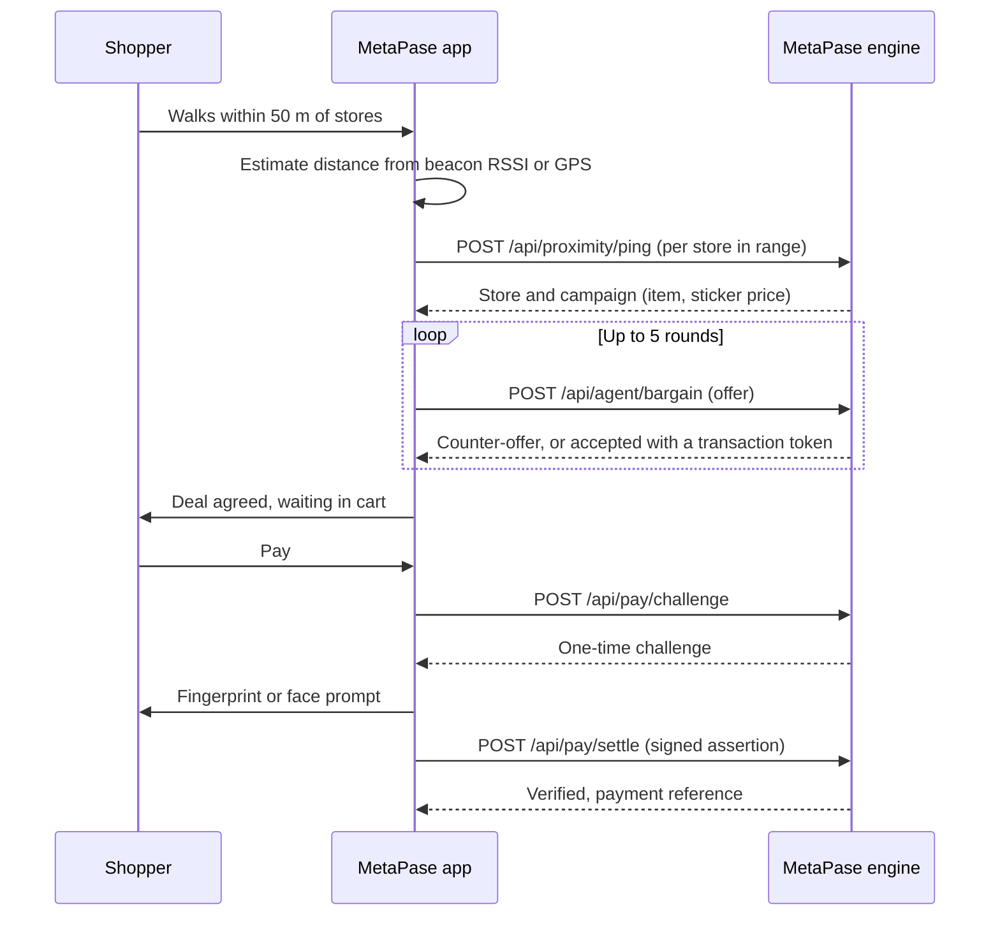

<div align="center">

# 🧭 MetaPase: Meta Proximity Autonomous Shopping Engine

**An autonomous shopping agent that finds deals within 50 metres, negotiates the price, and checks out with a passkey.**

Built for the Meta AI Hackathon 2026.


</div>

---

## Contents

- [Overview](#overview)
- [Features](#features)
- [How it works](#how-it-works)
- [Getting started](#getting-started)
- [Configuration](#configuration)
- [API reference](#api-reference)
- [Project structure](#project-structure)
- [Device views](#device-views)
- [Browser support and limitations](#browser-support-and-limitations)
- [Roadmap](#roadmap)
- [Contributing](#contributing)
- [License](#license)

## Overview

MetaPase turns a phone, smart glasses, a watch or a car dashboard into a proximity shopping assistant. As you move through a mall or along a street, it works out which stores are within 50 m, asks each store's ad service for its current promotion, and sends an agent to negotiate the price on items that match what you are shopping for. Agreed deals land in your cart. You approve every payment with a passkey (fingerprint, face or device PIN), unless you switch on auto-buy.

The project has two parts:

- **App** (`src/`): a React 19 single-page app with a heading-aware deal carousel, a digital compass, and pages for discovery, history, cart and settings.
- **Engine** (`server/server.ts`): a dependency-free Node.js server that resolves beacon proximity, serves store campaigns, runs the store's side of the negotiation, and verifies passkey-signed payments.

A built-in **demo mode** simulates five stores in the browser, so the whole flow can be shown without the server.

## Features

**Finding deals**
- Indoor positioning from Bluetooth beacon signal strength, with least-squares trilateration when three or more stores are heard
- Outdoor positioning from GPS, switching automatically on fix accuracy
- Real iBeacon scanning through the Web Bluetooth Scanning API where the browser supports it, with test sliders as a fallback
- Category filter (apparel, footwear, groceries, electronics, beauty) and a per-item budget

**The agent**
- Autopilot scans every 6 seconds and negotiates matching deals, nearest first
- Opens at 75% of the sticker price, then meets the store halfway, for up to five rounds, never above your budget
- Deals it cannot close go to **Parked**, where you can buy at the store's last price, watch for a lower price, or discard
- Optional **auto-buy** pays for agreed deals that match your intent and budget

**The interface**
- Physics-driven, continuously gliding deal carousel arranged by compass direction, speeding up as you walk and as more deals appear
- Digital compass bar showing your heading and the bearing to the selected store, in both directions
- Full-screen deal view with pricing, discount, budget fit, location and negotiation history
- Matching deals surface and flash; parked and bought items dive into the Parked and Bag buttons
- Floating expandable navigation: Home, Discover, Timeline, Cart and Settings
- Timeline of wishlist items, purchases and nearby promotions
- Separate layouts for desktop, mobile, watch, glasses, car and voice

**Payments**
- WebAuthn passkey registration on first payment
- Each payment signs a one-time server challenge bound to its transaction token
- The server verifies the signature, the relying-party domain and the user-verification flag
- Single-use transaction tokens that expire after 10 minutes

## How it works



**Distance.** Signal strength is converted to distance with a log-distance path-loss model (1 m reference power of −59 dBm, exponent 2.5). Outdoors, distance and bearing come from the GPS fix and each store's mapped position.

**Position.** With three or more stores in range, the app solves a weighted least-squares trilateration and rejects implausible results. With fewer, it falls back to a distance-weighted average of the beacon positions.

**Negotiation.** The store accepts any offer at or above its floor price. Below the floor, its counter moves 40% of the way toward the offer each round, so a negotiation converges within a few rounds.

**Payments.** On first use the app creates a passkey and sends its public key to the engine. To pay, the app asks the engine for a challenge tied to the transaction token, signs it with the passkey, and the engine verifies the assertion before settling.

## Getting started

### Requirements

- Node.js 20 or newer
- A modern browser. Chrome is needed for real beacon scanning (see [limitations](#browser-support-and-limitations)).

### Install and run

```bash
git clone <your-repository-url>
cd metapase
npm install
```

Start the engine and the app in two terminals:

```bash
npm run server   # engine on http://localhost:3000
npm run dev      # app on http://localhost:5173
```

Open http://localhost:5173. Check the engine at http://localhost:3000/api/health.

### Demo mode

To run without the engine, choose **Demo stores** in Settings, or create a `.env` file:

```bash
VITE_METAPASE_DATA_SOURCE=demo
```

Demo stores bargain inside the browser and nothing is charged.

### Production build

```bash
npm run build
npm run preview
```

## Configuration

### App (`.env`)

| Variable | Default | Description |
| --- | --- | --- |
| `VITE_METAPASE_API_BASE` | `http://localhost:3000` | Address of the MetaPase engine |
| `VITE_METAPASE_DATA_SOURCE` | `live` | `live` for the engine, `demo` for simulated stores |

Store positions, beacon UUIDs, the 50 m match radius, scan interval and negotiation limits live in `src/config/venue.ts`.

### Engine (environment variables)

| Variable | Default | Description |
| --- | --- | --- |
| `PORT` | `3000` | Port to listen on |
| `METAPASE_MATCH_RADIUS_M` | `50` | Maximum beacon distance for a match, in metres |
| `METAPASE_RP_ID` | `localhost` | Passkey relying-party domain; must match the app's hostname |
| `METAPASE_ALLOWED_ORIGINS` | `http://localhost:5173`, and others | Comma-separated app origins allowed to register and use passkeys |
| `METAPASE_ALLOW_SANDBOX_PAY` | `true` | Accept the `sig_valid` sandbox signature where passkeys are unavailable; set `false` to require passkeys |

## API reference

All endpoints accept and return JSON. Errors return `{ "error": "CODE", "message": "..." }`.

| Method | Path | Purpose |
| --- | --- | --- |
| `GET` | `/api/health` | Engine status and configuration |
| `POST` | `/api/proximity/ping` | Resolve the nearest known beacon and return its campaign |
| `POST` | `/api/agent/bargain` | Submit an offer; returns a counter-offer or an accepted price with a token |
| `POST` | `/api/pay/passkey/challenge` | Get a challenge to register a passkey |
| `POST` | `/api/pay/passkey/register` | Register a passkey's public key |
| `POST` | `/api/pay/challenge` | Get a payment challenge bound to a transaction token |
| `POST` | `/api/pay/settle` | Settle a payment with a passkey assertion or the sandbox signature |

<details>
<summary><strong>Request and response examples</strong></summary>

**Proximity ping**

```json
{
  "deviceId": "dev_3f9a1c2e",
  "timestamp": "2026-10-27T08:35:15.000Z",
  "telemetry": {
    "ble": [{ "uuid": "b9407f30-f5f8-466e-aff9-25556b57fe6e", "rssi": -76 }],
    "wifi": []
  },
  "userContext": { "currentIntent": "apparel", "maxBudgetZAR": 600 }
}
```

```json
{
  "resolvedLocation": { "mallId": "bel-air-shopping-centre", "outletId": "zara", "outletName": "Zara Fashion" },
  "adContext": { "campaignId": "camp_zara_01", "sku": "ZARA-BLAZER-01", "itemName": "Tailored Linen Blazer", "stickerPriceZAR": 650 },
  "distanceM": 4.8
}
```

**Bargain**

```json
{ "sessionId": "sess_zara_8c1d", "campaignId": "camp_zara_01", "agentOfferZAR": 488, "rationale": "Round 1 of 5." }
```

```json
{ "status": "COUNTER_OFFER_PROPOSED", "finalPriceZAR": 585 }
```

```json
{ "status": "OFFER_ACCEPTED", "finalPriceZAR": 537, "transactionToken": "mp_token_..." }
```

**Settle**

```json
{
  "transactionToken": "mp_token_...",
  "authPayload": {
    "mechanism": "webauthn",
    "credentialId": "...",
    "clientDataJSON": "...",
    "authenticatorData": "...",
    "signature": "..."
  }
}
```

```json
{ "success": true, "referenceId": "MPAY-REG-748017", "verified": true, "amountZAR": 537 }
```

</details>

## Project structure

```
metapase/
├── agent/
│   └── negotiateProximityRetailDeal.json   Function-calling schema for a Llama agent
├── server/
│   └── server.ts                           MetaPase engine (Node.js, no dependencies)
├── src/
│   ├── App.tsx                             Layout, pages, device views and animations
│   ├── components/                         Carousel, compass bar, deal cards, detail view, nav, sheets
│   ├── config/venue.ts                     Stores, beacons, radius and timing
│   ├── hooks/
│   │   ├── useDealEngine.ts                Autonomous scanning, negotiation and payment
│   │   ├── useCommerce.ts                  Parked items, watch list, cart, purchases, timeline
│   │   ├── useBeaconScanner.ts             Live Bluetooth readings
│   │   ├── useGeolocation.ts               GPS
│   │   ├── useHeading.ts                   Device compass
│   │   └── useMotionSpeed.ts               Walking speed estimate
│   ├── lib/
│   │   ├── api.ts                          Engine client
│   │   ├── demoBackend.ts                  Simulated stores
│   │   ├── metaPay.ts                      Passkey registration and payment signing
│   │   ├── bluetoothScanner.ts             iBeacon scanning and parsing
│   │   ├── trilateration.ts                Least-squares position solver
│   │   ├── positioning.ts                  Indoor and outdoor position estimate
│   │   └── geo.ts                          Distance, bearing and path-loss maths
│   ├── pages/                              Timeline, Cart and Settings
│   └── types/metapase.ts                   Shared data models
├── index.html
├── package.json
└── vite.config.ts
```

## Device views

The app detects the device from its user agent and screen shape, and every view can also be chosen from the top banner.

| View | Layout |
| --- | --- |
| Desktop | Compass bar and carousel, with the full deal grid on Discover |
| Mobile | Single column, touch-first |
| Watch | Compact compass and one card at a time |
| Glasses | Transparent heads-up display with a heading tape |
| Car | Large controls; pay only when parked |
| Voice | Spoken directions, agreements and payments |

## Browser support and limitations

- **Bluetooth scanning** uses the Web Bluetooth Scanning API, which currently works only in Chrome with `chrome://flags/#enable-experimental-web-platform-features` enabled, over HTTPS or localhost. Safari, iOS and most other browsers do not support it; the app falls back to manual signal sliders.
- **GPS and the device compass** require HTTPS or localhost. iOS asks for compass permission on first use.
- **Passkeys** require HTTPS or localhost and do not work inside embedded frames, where the app uses the sandbox signature instead.
- **Meta Pay is simulated.** Passkey signing and verification are real, but no money moves and no payment network is called.
- **The negotiation agent is rule-based.** `agent/negotiateProximityRetailDeal.json` lets a Llama model call it as a tool, but no model is connected in this repository.
- **Engine storage is in memory.** Campaigns, sessions, tokens and passkeys reset when the server restarts; the app re-registers passkeys automatically.
- **App data** (cart, parked items, watch list, purchases, timeline, profile) is stored in the browser's local storage.

## Roadmap

- Connect a Llama model to drive offers through the tool schema
- Persist campaigns, passkeys and receipts in a database
- Native companion app for reliable background beacon scanning on iOS and Android
- Merchant dashboard for creating campaigns and floor prices
- Integration with a real payment provider

## Contributing

1. Fork the repository and create a branch: `git checkout -b feature/your-change`
2. Make your change and run `npm run build` to type-check
3. Commit with a clear message and open a pull request describing what changed and why

## License

No license has been chosen yet. Until a `LICENSE` file is added, all rights are reserved by the authors.

---

<div align="center">
Built for the Meta AI Hackathon 2026
</div>
