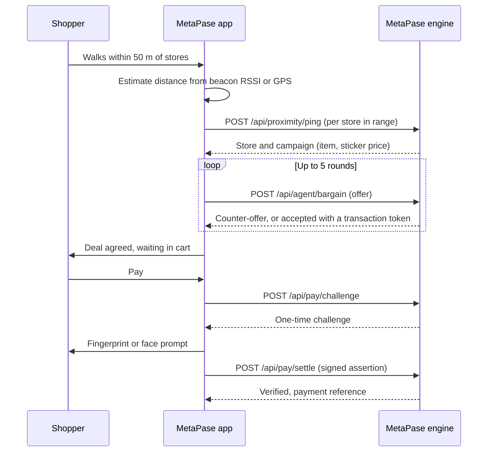

<div align="center">

# 🧭 MetaPase: Meta Proximity Autonomous Shopping Engine

**An autonomous shopping agent that finds deals within 50 metres, negotiates the price, and checks out with a passkey.**

Built for the Meta AI Hackathon 2026.


</div>

---

## Contents

- [Origin & Heritage](#origin--heritage)
- [Meta AI Hackathon Build Log](#meta-ai-hackathon-build-log-oct-26--nov-4-2026)
- [Overview](#overview)
- [Demo in 60 seconds](#demo-in-60-seconds)
- [Muse Spark AI integration](#muse-spark-ai-integration)
- [Features](#features)
- [How it works](#how-it-works)
- [Getting started & NPM scripts](#getting-started--npm-scripts)
- [Configuration](#configuration)
- [API reference](#api-reference)
- [Project structure](#project-structure)
- [Device views](#device-views)
- [Browser support and limitations](#browser-support-and-limitations)
- [Roadmap & Completed milestones](#roadmap--completed-milestones)
- [Contributing](#contributing)
- [License](#license)

## Origin & Heritage

MetaPase is a **complete rebuild and significant extension** of my earlier project, **AutoComm** (Autonomous Commerce Engine), originally hosted at [`github.com/gugunyathi/autocomm`](https://github.com/gugunyathi/autocomm.git).

AutoComm was a generalist autonomous commerce framework exploring proximity retail, agent negotiation, and passkey payments. For the **Meta Global AI Developer Hackathon 2026** I cloned AutoComm and rebuilt it from the ground up in a leaner, purpose-built style — cutting scope, tightening the type system, and re-centering every feature around **Meta's AI stack** (Muse Spark) and the specific challenge of real-time proximity shopping inside South African malls.

| | AutoComm (origin) | MetaPase (this repo) |
|---|---|---|
| **Core purpose** | General autonomous commerce | Proximity shopping inside 50 m beacon radius |
| **AI layer** | Generic LLM hooks | Meta Muse Spark 1.3 — two-sided merchant + shopper agents |
| **Payment rails** | Stripe Issuing sandbox | WebAuthn passkeys + PayPal Commerce Platform Pay Later |
| **Physical world** | Simulated only | 31 real stores mapped across 4 Gauteng malls + 3 virtual transit hubs |
| **Multi-device** | Mobile only | Desktop, Mobile, Smartwatch, AR Glasses HUD, Car, Voice |
| **Virtual retail** | — | Shopify catalog ingestion with 75% floor-margin isolation |
| **Backend** | In-memory demo | Node.js HTTP server + MongoDB Atlas + Vercel serverless |

The git merge commit `f27c1f5bc` on 4 Nov 2026 formally merges the AutoComm lineage into the MetaPase main branch, preserving full attribution history.

---

## Meta AI Hackathon Build Log (Oct 26 – Nov 4, 2026)

The Meta Global AI Developer Hackathon kicked off **Monday 26 October 2026 at 12:00 PM PT**. Everything below was designed, built, tested, and deployed between that moment and **Tuesday 4 November 2026**.

### 🏁 Day 1 — Oct 27 · Foundations & Core Engine

| Commit | What was shipped |
|---|---|
| `16cf1d4` | **Initial MetaPase scaffold** — mall detection, proximity zones, and product cards. Renamed from AutoComm, re-scoped to Meta AI Hackathon. |
| `27c590a` | `vercel.json` SPA deployment config so the app routes correctly on Vercel. |
| `b8868b4` | Hardened `.gitignore` — blocks all `.env` variants, certs, keys, and build artifacts. |
| `71f74e0` | Sanitized `.env.example` with MongoDB URI placeholder and documented all server secrets. |
| `6494fc3` | **Meta Muse Personal Agent Protocol** — full MCP tool schema (`negotiateProximityRetailDeal.json`), personal shopping agent runner, and Stripe Issuing sandbox for agent-issued cards. |
| `9217db5` | **31 Autonomous Merchant Agents** — all 31 mapped stores now have live Muse-driven agent personalities capable of autonomous and manual price negotiation. |
| `2736d30` | **WebAuthn passkey auth** (signup, signin, biometric checkout), **R1,000 welcome credit promo**, freeform voice/text wishlist, and discount buy/park listener. |
| `18e65986` | **Complete REST API** — all core endpoints (`/proximity/ping`, `/agent/bargain`, `/pay/settle`, `/muse/*`, `/merchant/*`), MongoDB client with zero-config in-memory fallback, and full session management. |
| `540d483` | **Full database persistence** — 31 merchant stores, live inventory shelf counts, transaction ledgers, analytics dashboards, and real-time activity audit feed committed to MongoDB. |
| `af5fd5a` | **Point-of-Sale auto-financing** — 12-month installment plans, user credit profiles, and POS financing engine. |

### 🔥 Day 9 — Nov 3 · Agent Creation Flow

| Commit | What was shipped |
|---|---|
| `db4670e` | **Personal agent creation flow** — guided onboarding UI that provisions a named personal agent, sets shopping intent, and activates autopilot for the first scan cycle. |

### 🚀 Day 10 — Nov 4 · AI, Payments, Virtual Retail & Polish

| Commit | What was shipped |
|---|---|
| `f27c1f5` | Merged AutoComm origin history into MetaPase main (git heritage preservation). |
| `556e728` | **Meta Muse Spark 1.3 integration** — two-sided autonomous bargaining (merchant agent + shopper agent), stock-aware store campaigns, agent onboarding, and `MuseBadge` live connection status indicator. |
| `6343c7a` | **Muse reasoning tokens** enabled, live MongoDB Atlas URI validation on startup, and startup location permission prompt. |
| `b95ea6a` | **Demo-mode auto-fallback** — app automatically switches to in-browser simulated stores on backend failure; dynamic backend campaigns; MongoDB inventory seeding script. |
| `84c38d5` | **Vercel build fix** — scoped `tsconfig`, switched to `vite build` to resolve Vercel CI failures. |
| `dadadcc` | **Explicit intent gate** — deal cards only park to bag when the user has set a wishlist item or explicit shopping intent (prevents ghost purchases). |
| `55633ca` | Tailwind v4 custom CSS data added for VS Code IntelliSense autocomplete. |
| `c5c685d` | **Full session persistence in MongoDB** — transaction receipts, passkey credential storage, and inventory tracking all durable across server restarts. |
| `404c626` | **PayPal Commerce Platform Pay Later rails** — `@paypal/react-paypal-js` integrated alongside Muse Spark flow; Pay in 4 / Pay Monthly installment logic; `PayPalPaymentContainer`, `PayPalPayLaterButton`, `PayPalStandardButton` components. |
| `b198e39` | `.env.example` updated with pre-populated PayPal sandbox credentials and agent payment settings for instant copy-to-`.env` onboarding. |
| `c2956e8` | PayPal endpoints routed through `API_BASE`, **A2A Transaction Audit Ledger** added (`A2ATransactionAuditLedger.tsx`), bag/purchases sync, Vercel CORS headers. |
| `46bfdb7` | TypeScript diagnostics resolved — ag-grid community declarations, Vite env typings, and path alias fixes. |
| `d7b26a3` | PayPal env key normalization — both `VITE_PAYPAL_CLIENT_ID` and `VITE_PAYPAL_SANDBOX_CLIENT_ID` are accepted interchangeably. |
| `ee380c2` | ag-grid and Vite environment type declaration formatting. |
| `375167e` | **Virtual Retail Presence framework** — Shopify public catalog ingestion, 75% mathematical floor margin isolation, 3 virtual transit hub anchor locations (Park Station, FNB Stadium, Sandton Gautrain), cyan-neon Shopify fulfillment badges across carousel/cards/detail views, and Muse negotiation agent floor protection for virtual stores. |

### 📊 Hackathon Totals at Cut-off (Nov 4, 2026)

| Metric | Count |
|---|---|
| Commits since hackathon kickoff | **25** |
| New source files created | **15+** |
| Automated guardrail tests passing | **17 / 17** |
| Physical stores mapped | **31** (across Eastgate, Sandton City, Mall of Africa, Bel Air) |
| Virtual transit hub anchors | **3** (Park Station, FNB Stadium, Sandton Gautrain) |
| Device view layouts | **6** (Desktop, Mobile, Watch, AR Glasses, Car, Voice) |
| Payment rails | **3** (WebAuthn passkeys, PayPal Standard, PayPal Pay Later) |
| AI models supported | **2** (`muse-spark-1.3`, `meta-models/muse-spark-open-1026`) |

---

## Overview

MetaPase turns a phone, smart glasses, a watch or a car dashboard into a proximity shopping assistant. As you move through a mall or along a street, it works out which stores are within 50 m, asks each store's ad service for its current promotion, and sends an autonomous AI agent to negotiate the price on items that match what you are shopping for. Agreed deals land in your cart. You approve every payment with a passkey (fingerprint, face or device PIN), unless you switch on auto-buy.

The project consists of:

- **App** (`src/`): a React 19 single-page app with heading-aware physics deal carousel, digital compass, natural-language voice/text wishlist, and responsive layouts for desktop, mobile, watch, glasses, car, and voice.
- **Engine** (`server/server.ts` & `server/muse.ts`): a Node.js server that resolves proximity, hosts campaign negotiations, verifies passkey signatures, and coordinates **Meta Muse Spark** on both buyer and seller sides with strict code-enforced guardrails.
- **Data Layer** (`server/db.ts` & `src/lib/demoStore.ts`): full MongoDB persistence with automatic in-memory fallback, tracking live stock across 31 stores, transactions, vouchers, and audit feeds.
- **Serverless API** (`api/muse/[action].ts`): Vercel-ready serverless function executing Muse Spark without requiring a standalone backend server.

A built-in **demo mode** simulates stores directly in the browser with live stock and local auto-negotiation, so the entire experience works instantly out of the box.

## Demo in 60 seconds

1. `npm install && npm run dev` and open `http://localhost:5173`. No server, database or API key is required.
2. Click **Create my agent** on the onboarding card. Your agent is provisioned immediately with R1,000 welcome credit and starts shopping on autopilot: nearby deals glide in, counter-offers are negotiated, and winning items are purchased or parked.
3. Open **Discover**, tap any store to explore its **Merchant Hub** (live inventory, recent sales ledger, and voucher redemption), or perform a manual purchase.
4. For the full live AI stack: copy `.env.example` to `.env`, set `MODEL_API_KEY` (and optional `MONGODB_URI`), then run `npm run dev:all`.

See `HACKATHON.md` for our submission details and `DEMO_SCRIPT.md` for the video demo walkthrough.

## Muse Spark AI integration

MetaPase uses Meta's **Muse Spark** (`muse-spark-1.3`) or open weights (`meta-models/muse-spark-open-1026`) on **both sides of the same retail transaction**:

| Participant | Role | What Muse handles | Deterministic code guardrails |
| --- | --- | --- | --- |
| **Store (Merchant) Agent** | Seller | Determines counter-offer pricing and writes customer-facing reasoning | Offer can never drop below floor price; cannot exceed previous counter; cannot leak floor price in copy |
| **Shopper (Personal) Agent** | Buyer | Parses freeform voice/text wishes into structured constraints | Shopper's stated numerical budget strictly overrides AI inference; values bounded |
| **Merchant Insights** | Advisory | Analyzes stock turnover and sales metrics via `POST /api/muse/insights` | Strategic recommendations only; cannot independently alter catalogue prices |

### Setup & Verification

1. Copy `.env.example` to `.env` and set `MODEL_API_KEY` (server-side only, never prefixed with `VITE_`):
   ```bash
   MODEL_API_KEY=your_meta_model_api_key
   MUSE_API_BASE=https://api.meta.ai/v1
   MUSE_MODEL=muse-spark-1.3
   ```
2. Verify connectivity with `npm run muse:check`. This performs a live test of both merchant counter-offering and wishlist intent parsing.
3. Start the application with `npm run dev:all`. The header status badge reflects the live state:
   - 🟢 **Muse Spark**: Connected and actively driving negotiations.
   - 🟡 **Muse paused**: Circuit breaker engaged (auto-recovers after 30s) or failing over.
   - ⚪ **Rules agent**: Running deterministic rules fallback (when no API key is provided).

### Safety & Resilience
- **Circuit Breaker:** Automatically trips and pauses AI requests for 30 seconds after 3 consecutive errors or timeouts.
- **Strict Timeouts:** 6-second timeout before falling back to rules-based negotiation.
- **Redaction:** API keys and sensitive tokens are completely scrubbed from error logs and public endpoints.
- **Guardrail Test Suite:** Run `npm test` to execute 17 automated test cases validating that adversarial model outputs never breach floor prices or leak sensitive data.

### Running on Muse Spark Open (Open Weights)
To run on the open-weight model `meta-models/muse-spark-open-1026` hosted on Baseten or any OpenAI-compatible provider:
```bash
MUSE_API_BASE=https://model-xxxxxx.api.baseten.co/v1
MODEL_API_KEY=your_baseten_key
MUSE_MODEL=meta-models/muse-spark-open-1026
```
Our parsing layer automatically strips chain-of-thought and preamble tokens emitted by open-weight models. Run `npm run muse:check` to validate.

## Features

**Two-Sided AI Negotiation (Meta Muse Spark)**
- Powered by `muse-spark-1.3` (or open-weight `meta-models/muse-spark-open-1026` via Baseten)
- **Store agent:** Generates contextual counter-offers and natural-language justifications per round
- **Personal shopping agent:** Evaluates deals against user intent, urgency, and budget
- **Muse proposes, code decides:** Mathematical floor prices, round limits, and budget constraints are strictly enforced in deterministic code; store floors cannot leak
- Seamless fallback to deterministic rules-based negotiation if offline or without an API key

**One-Tap Agent Onboarding & Natural Language Wishlist**
- Instant one-tap agent deployment with R1,000 welcome credit promo
- Freeform voice or text wishlist: Muse extracts item names, categories, keywords, and budget constraints
- Shopper's explicitly stated budget always overrides AI-inferred values

**Stock-Aware Inventory & Merchant Hub**
- Live shelf tracking across 30+ stores in 4 Johannesburg malls
- Out-of-stock items are automatically excluded from broadcasts
- Checkout decrements real inventory and issues verifiable merchant redemption vouchers
- **Merchant Hub:** Store managers can inspect inventory, view real-time sales ledgers, redeem vouchers, and receive AI-driven inventory insights ("Ask Muse")

**Finding Deals & Indoor Positioning**
- Indoor positioning from Bluetooth beacon signal strength, with least-squares trilateration when three or more stores are heard
- Outdoor positioning from GPS, switching automatically based on fix accuracy
- Real iBeacon scanning through Web Bluetooth Scanning API, with manual test sliders as fallback
- Category filter (apparel, footwear, groceries, electronics, beauty) and per-item budget controls

**Autonomous Autopilot**
- Scans every 6 seconds and negotiates matching deals, nearest first
- Multi-round counter-offers converging toward fair market value
- Deals that cannot close at or below budget move to **Parked** for manual review, watchlisting, or one-tap purchase
- Optional **auto-buy** automatically settles deals matching high-priority wishlist items

**The Interface**
- Physics-driven, continuously gliding deal carousel arranged by compass direction, adapting speed to user walking velocity
- Digital compass bar showing your heading and bearings to nearby stores
- Full-screen deal view with dynamic pricing, discounts, budget fit, and full negotiation transcript
- Layouts tailored for Desktop, Mobile, Smart Glasses (HUD), Smartwatch, Car Dashboard, and Voice

**Payments & Security**
- WebAuthn passkey registration on first checkout (Face ID, Touch ID, Windows Hello, PIN)
- Cryptographic challenge-response signing tied to single-use 10-minute transaction tokens
- Sandbox signature fallback for environments without WebAuthn hardware support

## How it works



**Distance.** Signal strength is converted to distance with a log-distance path-loss model (1 m reference power of −59 dBm, exponent 2.5). Outdoors, distance and bearing come from the GPS fix and each store's mapped position.

**Position.** With three or more stores in range, the app solves a weighted least-squares trilateration and rejects implausible results. With fewer, it falls back to a distance-weighted average of the beacon positions.

**Negotiation.** The store accepts any offer at or above its floor price. Below the floor, its counter moves 40% of the way toward the offer each round, so a negotiation converges within a few rounds.

**Payments.** On first use the app creates a passkey and sends its public key to the engine. To pay, the app asks the engine for a challenge tied to the transaction token, signs it with the passkey, and the engine verifies the assertion before settling.

## Getting started & NPM scripts

### Requirements

- Node.js 20 or newer
- A modern browser. Chrome is needed for real Bluetooth scanning (see [limitations](#browser-support-and-limitations)).

### Install and run

```bash
git clone https://github.com/gugunyathi/metapase.git
cd metapase
npm install
```

#### Run both Server and App together:
```bash
npm run dev:all
```
This starts the backend engine on `http://localhost:3000` and the frontend on `http://localhost:5173`.

#### Run individually:
```bash
npm run server   # engine on http://localhost:3000
npm run dev      # frontend on http://localhost:5173
```

### Useful scripts

| Command | Action |
| --- | --- |
| `npm run dev:all` | Run backend server and Vite frontend concurrently |
| `npm run muse:check` | Verify Meta Muse Spark API key, endpoint, model response, and live test |
| `npm test` | Run 17 automated Muse Spark safety guardrail tests against adversarial inputs |
| `npm run typecheck` | Perform end-to-end TypeScript validation (`tsconfig.json` & `tsconfig.server.json`) |
| `npm run build` | Compile TypeScript and bundle frontend for production |
| `npm run agent:shopping` | Run standalone personal shopping agent simulation via CLI |

### Demo mode

To run in zero-configuration mode without MongoDB or Meta API keys, simply open `http://localhost:5173` and click **Create my agent**. The app operates fully in-browser with simulated store agents, stock decrements, and rules-based fallbacks.

## Configuration

Copy `.env.example` to `.env` to configure optional live backend services:

```bash
cp .env.example .env
```

### Frontend (`.env`)

| Variable | Default | Description |
| --- | --- | --- |
| `VITE_METAPASE_API_BASE` | `http://localhost:3000` | Address of the MetaPase engine |
| `VITE_METAPASE_DATA_SOURCE` | `live` | `live` to connect to backend engine, `demo` for browser-only simulation |

### Server & AI (`.env`)

*Note: Never prefix server secrets with `VITE_`.*

| Variable | Default | Description |
| --- | --- | --- |
| `MONGODB_URI` | *(empty: uses in-memory)* | MongoDB connection string (e.g. `mongodb+srv://...`) |
| `MODEL_API_KEY` | *(empty: uses rules fallback)* | Meta Model API key for Muse Spark |
| `MUSE_API_BASE` | `https://api.meta.ai/v1` | Muse API base URL (or Baseten URL for open weights) |
| `MUSE_MODEL` | `muse-spark-1.3` | Model identifier (`muse-spark-1.3` or `meta-models/muse-spark-open-1026`) |
| `MUSE_TIMEOUT_MS` | `6000` | Request timeout for AI completions before falling back to rules |
| `PORT` | `3000` | Port for the Node.js server |
| `METAPASE_MATCH_RADIUS_M` | `50` | Maximum beacon distance for a match, in metres |
| `METAPASE_RP_ID` | `localhost` | Passkey relying-party domain; must match hostname |
| `METAPASE_ALLOWED_ORIGINS` | `http://localhost:5173` | Comma-separated CORS origins allowed to access the server |
| `METAPASE_ALLOW_SANDBOX_PAY` | `true` | Accept sandbox signature when WebAuthn hardware is absent |

## API reference

All endpoints accept and return JSON. Errors return `{ "error": "CODE", "message": "..." }`.

### Core Engine & Negotiation Endpoints

| Method | Path | Purpose |
| --- | --- | --- |
| `GET` | `/api/health` | Engine status, MongoDB state, and Muse Spark connectivity check |
| `POST` | `/api/proximity/ping` | Resolve nearest known beacon / coordinates and return matching active campaign |
| `POST` | `/api/agent/bargain` | Submit shopper offer; returns counter-offer or accepted deal with transaction token |
| `POST` | `/api/muse/bargain` | AI counter-offer calculation via Muse Spark with strict guardrails |
| `POST` | `/api/muse/wishlist` | Natural-language intent and wish parser (speech / text) |
| `POST` | `/api/muse/insights` | Strategic AI inventory and sales recommendations for merchants |
| `POST` | `/api/user/agent/create` | Instant one-tap agent provisioning with R1,000 welcome credit |
| `GET` | `/api/merchant/inventory` | Real-time store inventory, stock counts, and floor prices |
| `POST` | `/api/merchant/redeem` | Voucher code validation and in-store redemption |

### Authentication & Passkey Payments

| Method | Path | Purpose |
| --- | --- | --- |
| `POST` | `/api/pay/passkey/challenge` | Get a challenge to register a WebAuthn passkey |
| `POST` | `/api/pay/passkey/register` | Register a passkey's public key with the engine |
| `POST` | `/api/pay/challenge` | Get a payment challenge bound to a single-use transaction token |
| `POST` | `/api/pay/settle` | Settle payment with cryptographic passkey assertion or sandbox signature |

<details>
<summary><strong>Request and response examples</strong></summary>

**Proximity ping**

```json
{
  "deviceId": "dev_3f9a1c2e",
  "timestamp": "2026-10-27T08:35:15.000Z",
  "telemetry": {
    "ble": [{ "uuid": "b9407f30-f5f8-466e-aff9-25556b57fe6e", "rssi": -76 }],
    "wifi": []
  },
  "userContext": { "currentIntent": "apparel", "maxBudgetZAR": 600 }
}
```

```json
{
  "resolvedLocation": { "mallId": "bel-air-shopping-centre", "outletId": "zara", "outletName": "Zara Fashion" },
  "adContext": { "campaignId": "camp_zara_01", "sku": "ZARA-BLAZER-01", "itemName": "Tailored Linen Blazer", "stickerPriceZAR": 650 },
  "distanceM": 4.8
}
```

**Muse Spark Bargain (`/api/muse/bargain`)**

```json
{
  "storeName": "Zara Fashion",
  "itemName": "Tailored Linen Blazer",
  "stickerPrice": 650,
  "floorPrice": 450,
  "shopperOffer": 480,
  "previousStoreOffer": 600,
  "round": 2,
  "maxRounds": 5
}
```

```json
{
  "counterPrice": 530,
  "message": "We can meet you at R530 for this tailored linen blazer today.",
  "status": "COUNTER_OFFER_PROPOSED"
}
```

**Settle Payment (`/api/pay/settle`)**

```json
{
  "transactionToken": "mp_token_88e40...",
  "authPayload": {
    "mechanism": "webauthn",
    "credentialId": "cred_a1b2c3...",
    "clientDataJSON": "eyJ0eXBlIjoid2ViYXV0aG4uZ2V0IiwiY2hhbGxlbmdlIjoi...",
    "authenticatorData": "SZYN5YgOjGh0NBcPZHZgW4...",
    "signature": "MEUCIQD..."
  }
}
```

```json
{ "success": true, "referenceId": "MPAY-REG-748017", "verified": true, "amountZAR": 530 }
```

</details>

## Project structure

```
metapase/
├── api/
│   └── muse/[action].ts                    Vercel serverless function for Muse AI
├── agent/
│   ├── merchantAgents.ts                   Autonomous merchant agent definitions (31 stores)
│   ├── personalShoppingAgent.ts            Shopper autopilot negotiation runner
│   └── negotiateProximityRetailDeal.json   Tool calling schema for LLM agents
├── scripts/
│   ├── muse-check.ts                       Live health test for Muse Spark API & models
│   └── seed-db.ts                          MongoDB inventory seeding script
├── server/
│   ├── server.ts                           Backend HTTP API & proximity engine
│   ├── muse.ts                             Meta Muse Spark client & guardrail engine
│   ├── muse.test.ts                        17 safety & adversarial guardrail tests
│   ├── db.ts                               MongoDB client with in-memory fallback
│   └── routes/
│       └── paypal.ts                       PayPal Commerce Platform order & capture routes
├── src/
│   ├── App.tsx                             Main shell, device views & animation flow
│   ├── components/
│   │   ├── AgentOnboarding.tsx             One-tap agent creation with R1,000 promo
│   │   ├── MuseBadge.tsx                   Live Muse Spark connection status badge
│   │   ├── MerchantHubModal.tsx            Store management, stock, sales & AI insights
│   │   ├── WishlistModal.tsx               Voice/text natural language wish input
│   │   ├── PasskeyAuthModal.tsx            WebAuthn biometric checkout modal
│   │   ├── PayPalPaymentContainer.tsx      PayPal Commerce Platform pay rails wrapper
│   │   ├── PayPalPayLaterButton.tsx        Pay in 4 / Pay Monthly installment button
│   │   ├── A2ATransactionAuditLedger.tsx   Agent-to-agent transaction audit log grid
│   │   ├── DealCarousel.tsx                Physics-driven compass-aligned carousel (Shopify badges)
│   │   ├── DealCard.tsx                    Deal card with Shopify Virtual Presence badge
│   │   ├── DigitalCompassBar.tsx           Directional compass & store bearings
│   │   └── DealDetail.tsx                  Full deal breakdown & negotiation ledger (Shopify banner)
│   ├── config/
│   │   ├── malls.ts                        31 mapped stores + 3 virtual transit hubs
│   │   ├── products.ts                     Retail catalogue + 4 Shopify virtual drop products
│   │   └── venue.ts                        Beacon UUIDs, thresholds & timings
│   ├── hooks/
│   │   ├── useDealEngine.ts                Autonomous scan, bargain & buy orchestrator
│   │   ├── useCommerce.ts                  Cart, parked deals, wallet balance, orders & Shopify settlement
│   │   ├── useBeaconScanner.ts             Live Web Bluetooth iBeacon scanning
│   │   ├── useGeolocation.ts               GPS outdoor positioning
│   │   └── useHeading.ts                   Device orientation & digital compass
│   ├── lib/
│   │   ├── muse.ts                         Client-side Muse Spark caller & circuit breaker
│   │   ├── shopifyAdapter.ts               Shopify public catalog ingestion & 75% floor margin engine
│   │   ├── demoStore.ts                    In-browser merchant store with real stock tracking
│   │   ├── wishParse.ts                    Rule-based & AI natural language wish parser
│   │   ├── metaPay.ts                      WebAuthn passkey registration & assertion signing
│   │   ├── positioning.ts                  Indoor/outdoor location sensor fusion
│   │   └── trilateration.ts               Least-squares RSSI positioning solver
│   └── pages/                              DiscoverPage, CartPage, SettingsPage, TimelinePage
├── DEMO_SCRIPT.md                          3-minute video demo plan & script
├── HACKATHON.md                            Meta AI Hackathon submission notes & rubric mapping
├── index.html
├── package.json
├── tsconfig.json
├── tsconfig.server.json
└── vite.config.ts
```

## Device views

The app automatically adapts to the detected device or form factor (also selectable from the top banner):

| View | Layout & Experience |
| --- | --- |
| **Desktop** | Comprehensive dashboard with compass bar, gliding deal carousel, and Discover grid |
| **Mobile** | Touch-optimised single-column navigation with swipeable deal interaction |
| **Watch** | Ultra-compact glanceable UI displaying nearest deal and one-tap approval |
| **Glasses** | Heads-up display (HUD) with transparent tape and directional heading indicators |
| **Car** | High-contrast dashboard interface; purchasing gated to parked vehicle state |
| **Voice** | Audio-first interface with spoken deal briefings and voice-activated bargaining |

## Browser support and limitations

- **Bluetooth scanning:** Uses the Web Bluetooth Scanning API, supported in Chrome on desktop and Android (requires HTTPS/localhost and `chrome://flags/#enable-experimental-web-platform-features`). On other platforms, the app smoothly falls back to interactive simulated sliders.
- **GPS and Digital Compass:** Supported across all modern mobile and desktop browsers over HTTPS or localhost. iOS requires user authorization for motion sensors.
- **Biometric Passkeys:** Fully supported via WebAuthn across modern browsers (Touch ID, Face ID, Windows Hello, Android Biometrics). In non-secure contexts or embedded iframes, a cryptographically signed sandbox token is used.
- **Two-Sided AI Negotiation:** Runs on **Meta Muse Spark** (`muse-spark-1.3`) or **Muse Spark Open** (`meta-models/muse-spark-open-1026`). If no API key is configured or network is unavailable, deterministic rules-based negotiation executes automatically.
- **Storage:** Database persistence is managed via **MongoDB** with an automatic in-memory fallback. Client-side preferences and cart state persist to browser LocalStorage.

## Roadmap & Completed milestones

### ✅ Completed Milestones (Hackathon Sprint — Oct 26 → Nov 4, 2026)

- [x] **Meta Muse Spark 1.3 Integration:** Two-sided autonomous bargaining with model-driven copy and mathematical floor price guardrails across 31 merchant agents.
- [x] **Muse Spark Open Compatibility:** Fully tested with `meta-models/muse-spark-open-1026` on Baseten / any OpenAI-compatible endpoint.
- [x] **Personal Agent Onboarding:** One-tap agent creation, R1,000 welcome credit promo, named agent personality, and autopilot activation.
- [x] **Natural Language Wishlist:** Voice and text intent parsing with automatic budget, category, and keyword extraction; shopper budget always overrides AI inference.
- [x] **31 Autonomous Merchant Agents:** All 31 mapped stores fully staffed with live Muse-driven agent personalities.
- [x] **Stock-Aware Merchant Hub:** Live shelf counts, voucher generation and redemption, real-time sales feed, and AI inventory insights ("Ask Muse").
- [x] **Full MongoDB Persistence:** Transaction receipts, passkey credentials, inventory, session, and audit data — all durable with zero-config in-memory fallback.
- [x] **WebAuthn Passkey Payments:** Biometric checkout (Face ID, Touch ID, Windows Hello) with cryptographic challenge-response and sandbox fallback.
- [x] **PayPal Commerce Platform Pay Later:** `@paypal/react-paypal-js` rails alongside Muse flow; Pay in 4, Pay Monthly installments, and standard checkout in a single `PayPalPaymentContainer`.
- [x] **A2A Transaction Audit Ledger:** Agent-to-agent transaction log with ag-grid community data grid, full receipt history, and Vercel CORS.
- [x] **Virtual Retail Presence (Shopify):** 3 transit hub anchors (Park Station, FNB Stadium, Sandton Gautrain); Shopify public catalog ingestion; strict 75% floor margin isolation; cyan-neon fulfillment badges.
- [x] **Explicit Intent Gate:** Deal cards only auto-park when the user has an active wishlist item or declared shopping intent.
- [x] **Multi-Form Factor UI:** 6 tailored device layouts — Desktop, Mobile, Smartwatch, AR Glasses HUD, Car Dashboard, and Voice.
- [x] **Demo Mode Auto-Fallback:** Full in-browser simulation with real stock decrements and rules-based negotiation; no API key or backend required.
- [x] **Vercel + Render Deployment:** Serverless `api/muse/[action].ts` on Vercel; persistent Node.js backend on Render with MongoDB Atlas.

### 🔮 Future Roadmap
- [ ] **Native Mobile Companion:** Background Bluetooth beacon scanning for iOS and Android when the app is suspended.
- [ ] **Multi-Agent Cross-Store Auctions:** Shopper agents concurrently negotiating across multiple nearby stores for the lowest price.
- [ ] **Live Production Payment Gateways:** Promote PayPal from sandbox to production; add regional instant EFT settlement rails.
- [ ] **Shopify Webhook Live Sync:** Replace emulated inventory decrements with verified Shopify webhook event subscriptions.
- [ ] **AR Spatial Anchors:** Pin virtual store overlays to real-world coordinates via WebXR for Meta Quest / smart glasses.

## Contributing

1. Fork the repository and create a feature branch: `git checkout -b feature/your-feature`
2. Implement your changes and verify with:
   ```bash
   npm test             # Run guardrail tests
   npm run typecheck    # Run TypeScript checks
   npm run build        # Build frontend bundle
   ```
3. Commit with a clear message and open a pull request.

## License

All rights reserved by the authors for the Meta AI Hackathon 2026. Distributed under the MIT License once formally tagged.

---

<div align="center">
Built with ❤️ for the Meta Global AI Developer Hackathon 2026<br/>
Rebuilt from <a href="https://github.com/gugunyathi/autocomm.git">AutoComm</a> — cloned, stripped, and re-engineered for Meta AI.
</div>
